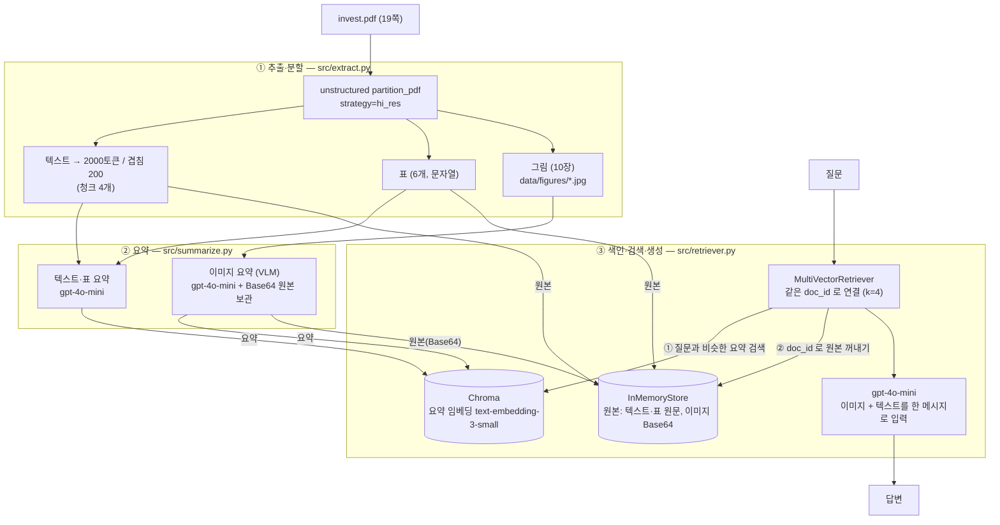

# 멀티모달 RAG — 한국은행 「금융기관·경제부문 간 상호연계」 보고서 질의응답

PDF 한 편에서 **텍스트·표·그래프(이미지)** 를 모두 뽑아 요약으로 검색하고, 답변은 **원본**으로 생성하는 멀티모달 RAG 파이프라인입니다.
텍스트만 쓰는 RAG(Before)와 같은 질문으로 비교했고, **잘 된 것과 안 된 것을 모두** 기록했습니다.

> 먼저 읽어야 할 결론 (자세한 내용은 [7. 한계점](#7-한계점))
> - 그림 4장을 검색하고 읽는 데는 성공했습니다. 질의 5건 모두 정답 그림이 검색됐습니다(5/5).
> - 그러나 **끝까지 정답인 답변은 5건 중 1건(Q2)** 입니다. 2건은 부분 정답, 2건은 오답입니다.
> - PDF의 한글 텍스트 레이어가 깨져 있어서 **텍스트·표 추출·요약이 사실상 쓸모없는 상태**입니다. 그 결과 5건 모두 이미지에서만 근거가 나왔고, Before(텍스트 전용)의 답변은 "모른다"이거나 환각입니다.

---

## 1. 문제 정의

**자료**: 한국은행의 상호연계 분석 보고서 (From-Whom-To-Whom 표, 2026년 3월판, 19쪽). 금융기관과 경제부문 사이의 채권·채무 규모를 표와 도식으로 보여 줍니다.
> 저작권: 한국은행 공개 자료. 저장소에는 PDF를 올리지 않았습니다(`.gitignore`의 `*.pdf`).

**왜 멀티모달이 필요한가** — 이 보고서의 핵심 수치는 본문 문장이 아니라 그림과 표 안에 있습니다.

| 질문 유형 | 답이 있는 곳 | 텍스트만으로 되는가 |
|---|---|---|
| "A가 B에 대해 가진 채권은?" | 〈표 4〉의 행·열 교차 셀 | 표가 이미지로 들어 있거나 글자가 뒤섞여 어렵다 |
| "어느 해에 두 선이 역전됐나?" | 선 그래프의 모양 | 본문에 없다 |
| "정부의 자산과 부채는?" | 파랑=부채, 초록=자산 범례가 있는 네트워크 도식 | 색 범례를 읽어야 한다 |
| "A에 자금을 댄 부문 중 두 번째로 큰 곳은?" | 화살표로 연결된 노드의 크기·수치 | 본문에 없다 |

PDF 선정 기준 충족 여부: 그래프·표 2개 이상(표 6개, 그림 10장), 10~30쪽(19쪽), 공개 자료(한국은행). 수업에서 쓴 PDF(39쪽)와는 다른 문서입니다.

## 2. 아키텍처

3단계 파이프라인입니다: **① 추출·분할 → ② 요약 → ③ 색인·검색·생성**



**핵심 아이디어 — 왜 "요약으로 검색하고 원본으로 생성"하는가**

- 그림과 표는 그대로는 임베딩해서 검색하기 어렵습니다. 그래서 각 그림·표를 **텍스트 요약으로 바꿔서 검색용 색인**에 넣습니다.
- 하지만 요약은 정보가 줄어들고 틀릴 수도 있습니다. 숫자 답이 필요한 질문에서는 치명적이므로, 검색이 끝나면 **요약이 아니라 원본(이미지 Base64, 표·텍스트 원문)** 을 꺼내서 모델에 넘깁니다. 요약 하나와 원본 하나에 같은 `doc_id`를 붙여 두기 때문에 가능합니다.
- 이 설계가 실제로 효과가 있었던 사례가 있습니다. `figure-9-2`의 요약은 "은행-기업 13.9%"라고 틀렸지만(실제 12.1%), Q2의 최종 답은 원본을 읽고 12.1%로 맞게 나왔습니다. 요약 오류가 곧바로 답변 오류가 되지는 않습니다.
- 다만 **원본을 넘긴다고 답이 항상 맞는 것은 아닙니다.** 모델이 원본을 잘못 읽는 오독은 별개의 문제이고, 실제로 Q4·Q5에서 발생했습니다([7. 한계점](#7-한계점) 참고).

## 3. 실행 방법

**준비**
1. Python 3.11, 시스템 도구 Tesseract(OCR)와 Poppler(PDF 렌더링)가 필요합니다. `unstructured`의 `hi_res` 모드 요구사항입니다.
2. 패키지 설치: `pip install -r requirements.txt`
3. 환경변수: `.env.example`을 `.env`로 복사하고 `OPENAI_API_KEY=` 뒤에 본인 키를 입력합니다. `.env`는 `.gitignore`에 들어 있어 커밋되지 않습니다.
4. PDF를 `data/invest.pdf`로 저장합니다(위 출처 참고).

**실행** — `notebooks/Multi_modal_RAG.ipynb`를 위에서부터 실행합니다.

| 단계 | 파일 | 하는 일 | 비용 |
|---|---|---|---|
| ① | `src/extract.py` | PDF → 텍스트·표·그림 분리, `data/figures/` 생성, `data/processed/extracted.pkl` 저장 | 로컬(약 2~3분) |
| ② | `src/summarize.py` | 텍스트·표·그림 요약 생성, `data/processed/summaries.pkl` 저장 | OpenAI API |
| ③ | `src/retriever.py` | 요약과 원본을 같은 `doc_id`로 색인하고 체인 구성 | OpenAI API (임베딩, 답변) |

노트북의 마지막 부분(요약 비교 + 질의 5건)이 이 README의 5·6장 표를 만든 셀입니다. 질의 5건은 이전에 저장된 `.pkl`(추출·요약 결과)을 불러와 색인한 뒤 실행했습니다.

**저장소 구조**
```
src/            extract.py · summarize.py · retriever.py
notebooks/      Multi_modal_RAG.ipynb
data/           (gitignore) invest.pdf · figures/ · processed/*.pkl
```

## 4. 기술 선택 근거

> 아래는 **설계 이유**입니다.

| 선택 | 이유 |
|---|---|
| **gpt-4o-mini** (요약·VLM·답변 모두) | 이미지를 입력받는 모델 하나로 요약부터 답변까지 처리할 수 있고, 비용이 낮아 이미지 10장·텍스트 청크 4개·표 6개를 반복 실행하기 부담이 적었습니다. 단점은 5장에서 보듯 도식 읽기 정확도가 낮다는 점입니다. |
| **청크 2000토큰 / 겹침 200** | 요약 모델이 한 번에 문맥을 보도록 충분히 크게 잡고, 경계에서 문장이 끊기는 것을 겹침으로 막았습니다. 이 PDF는 본문이 짧아 청크가 4개뿐이라 이 값의 영향은 작았습니다. |
| **`by_title` + hi_res 추출** | 제목 기준으로 의미 단위를 묶고, 표 구조(`infer_table_structure`)와 그림 저장(`extract_images_in_pdf`)을 같이 쓰려면 hi_res가 필요했습니다. |
| **프롬프트는 영어 지시 + "한국어로 출력"** | 지시문은 영어로 쓰는 편이 모델이 형식(3~4문장, 핵심 수치 위주)을 더 안정적으로 따른다고 보고 영어로 작성하되, 검색 대상이 한국어 질문이므로 요약은 반드시 한국어로 쓰도록 마지막 줄에 지시했습니다. 영어와 한국어 프롬프트를 비교하지는 않았습니다. |
| **text-embedding-3-small + Chroma** | 요약문 수가 20개로 작아 큰 임베딩 모델이 필요 없고, Chroma는 별도 서버 없이 로컬에서 바로 동작합니다. |
| **MultiVectorRetriever + InMemoryStore** | "요약은 검색용, 원본은 전달용"을 분리해서 저장하는 가장 단순한 방법입니다. |
| **temperature 0** | 같은 질문에 같은 답이 나오게 해서 Before/After 비교를 재현 가능하게 했습니다. |
| **검색 결과 4건(k=4)** | 요약 20개 중 질문과 가까운 4개면 정답 그림을 포함하기에 충분했습니다(5건 모두 포함). |

## 5. 질의응답 5건

질문은 모두 "그림·표를 봐야만 답이 나오는" 형태로 만들었습니다. 정답은 원본 그림에서 직접 읽은 값입니다. **"근거 원본 종류"는 실제로 검색된 원본**입니다.

| # | 질문 | 멀티모달 RAG 답변 | 정답 | 판정 | 근거 원본 종류 |
|---|---|---|---|---|---|
| Q1 | 2024년말 은행이 보험 및 연금기관에 대해 보유한 채권 규모와 총액 대비 비중은? | 206.3조원, 비중 21.6% | 206.3조원 (5.9%) | **부분 정답** | 이미지 4장 (`figure-10-3` 포함, 표) |
| Q2 | 2018~2024년 중 은행-기업 연계비율이 보험 및 연금기관-가계 비율과 교차한 시점과 2024년 두 값은? | 2021년, 12.1%, 10.2% | 2021년경, 12.1%, 10.2% | **정답** | 이미지 4장 (`figure-9-2` 포함, 선 그래프) |
| Q3 | 2024년 가계예금 증가 122.4조원 중 은행·비은행 기여분과, 기업예금에서 감소한 부문·금액은? | 은행 52.2, 비은행 39.6. 기업예금 감소 부문을 "41.7조원"이라 답함 | 은행 52.2, 비은행 39.6. 기업예금은 비은행 -16.3, 기타금융기관 -2.3 | **부분 정답** | 이미지 4장 (`figure-12-6` 포함, 누적 막대) |
| Q4 | 2024년말 채권-채무 구조에서 정부의 자산과 부채는 얼마이고 어느 쪽이 큰가? | 자산 1,179.6, 부채 415.4, "자산이 더 큼" | 자산 415.4, 부채 1,179.6, 부채가 더 큼 | **오답** (값이 뒤바뀜) | 이미지 4장 (`figure-15-8` 포함, 네트워크 도식) |
| Q5 | 투자펀드(부채 1,082.0)에 자금을 공급한 부문 중 두 번째로 큰 곳과 금액은? | 보험 및 연금, 359.2조원 | 정부 168.2조원 (1위가 보험 및 연금 359.2) | **오답** | 이미지 4장 (`figure-17-10` 포함, 네트워크 도식) |

- **검색**: 정답 그림이 검색된 건 **5/5** 입니다.
- **답변**: 완전 정답 1건, 부분 정답 2건, 오답 2건입니다.
- 5건 모두 **텍스트·표 원본은 한 번도 검색되지 않았습니다**(검색된 4건이 모두 이미지). 원인은 7장의 ①번입니다.
- Q1은 질문이 모호했습니다. 모델은 은행 행 합계(955.1) 대비 21.6%로 계산했는데, 표의 괄호 값은 *전체 총액* 대비 비율입니다(5.9%). 질문을 "표의 괄호 값 기준"으로 명시하지 않은 제 설계 문제입니다.

## 6. Before / After 비교

같은 질문을 **Before**(텍스트 전용 RAG: 텍스트 청크만 색인, 이미지·표 제외)와 **After**(멀티모달 RAG)에 넣었습니다. 모델·프롬프트·k값은 동일하고 이미지·표만 다릅니다.

### 6-1. 잘 된 사례 — Q2 (선 그래프)

원본 그래프(`data/figures/figure-9-2.jpg`):


```
Q: 2018~2024년 사이 은행-기업 연계비율이 보험 및 연금기관-가계 연계비율과 교차(역전)한 시점은 언제이고, 2024년 두 값은?

[BEFORE] 텍스트 전용 RAG
 자료에 따르면, 2018~2024년 사이 은행-기업 연계비율이 보험 및 연금기관-가계 연계비율과 교차(역전)한 시점에 대한
 정보는 제공되지 않았습니다. 또한 2024년 두 값에 대한 구체적인 수치도 명시되어 있지 않습니다.
 따라서 이 질문에 대한 답변은 모른다고 말씀드릴 수 있습니다.

[AFTER ] 멀티모달 RAG
 2018~2024년 사이 은행-기업 연계비율이 보험 및 연금기관-가계 연계비율과 교차(역전)한 시점은 2021년입니다.
 2024년 두 값은 은행-기업 연계비율이 12.1%이고, 보험 및 연금기관-가계 연계비율이 10.2%입니다.
```

**차이**: 텍스트만으로는 "모른다"였던 질문이, 그래프를 넣자 2021년·12.1%·10.2%로 맞게 답해졌습니다. 2021년은 두 선이 거의 맞닿는 지점이라 "그래프 판독 기준의 근사"입니다.

### 6-2. 5건 전체 비교

| # | Before (텍스트 전용) | After (멀티모달) | 비고 |
|---|---|---|---|
| Q1 | "정보가 제공되지 않았다 / 모른다" | 206.3조원은 맞고 비중은 틀림 | After 부분 개선 |
| Q2 | "모른다" | **정답** | After 개선 |
| Q3 | "구체적인 수치는 제공되지 않았다" | 은행·비은행은 맞고 기업예금 감소는 틀림 | After 부분 개선 |
| Q4 | "정부 자산 1,003,040, 부채 1,082,000, 부채가 더 큼" | 자산·부채를 뒤바꿔 "자산이 더 큼" | **둘 다 오답** |
| Q5 | "두 번째로 큰 곳은 168.542조원" (부문명 없음) | 보험 및 연금 359.2조원 | **둘 다 오답** |

### 6-3. 못 된 사례 — Q4 (네트워크 도식)

원본 도식(`data/figures/figure-15-8.jpg`). **파랑 = 부채, 초록 = 자산**입니다. 정부 노드에서 파란 큰 원 안의 1,179.6이 부채, 초록 원 안의 415.4가 자산입니다.


멀티모달 RAG는 정답 그림(`figure-15-8`)을 검색하고도 **범례의 색을 반대로 읽었습니다**. Before 쪽 숫자(1,003,040 / 1,082,000)는 어디에도 없는 값으로, 깨진 텍스트에서 다른 항목(투자펀드 부채 1,082.0 등)을 가져온 것으로 보입니다. "부채가 더 큼"이라는 방향은 우연히 일치했을 뿐 근거 있는 답이 아닙니다.

**요약**: After가 Before보다 나았던 건 Q2가 확실하고 Q1·Q3가 부분적입니다. Q4·Q5는 둘 다 실패했습니다. 이 비교만으로 "멀티모달 RAG가 항상 낫다"고 말할 수는 없습니다.

## 7. 한계점

지금 드러난 문제를 심각한 순서대로 정리했습니다.

**① 텍스트·표 추출이 깨졌습니다 (가장 큰 문제)**
- 추출된 텍스트가 `SAAS eee 7S SAA] But` 같은 글자로 저장돼 있습니다. `pdftotext`로 뽑아도 한글이 깨져서, PDF 폰트의 한글 매핑이 잘못된 것으로 **추정**됩니다. `hi_res`는 이런 PDF에서도 내장 텍스트 레이어를 그대로 쓴 것으로 보입니다.
- 결과: 텍스트 요약 4개는 "표입니다/데이터가 나열되어 있습니다" 수준의 일반적 문장이고, 표 요약 6개 중 하나는 "요약할 수 없습니다"입니다. 질의 5건에서 텍스트·표 원본이 **한 번도 검색되지 않았습니다**.
- 그래서 "텍스트·표·이미지를 모두 추출했다"는 말은 **개수로만 사실**(텍스트 7·표 6·이미지 10)이고, 텍스트·표의 내용 품질은 쓸 수 없는 수준입니다.

**② Before/After 비교의 공정성이 제한됩니다**
- Before가 실패한 이유가 "그래프를 못 봐서"인지 "텍스트가 깨져서"인지 구분되지 않습니다.
- 프롬프트에 "자료에 없는 내용은 모른다고 답하세요"를 넣었는데도 Q4·Q5의 Before는 깨진 글자에서 숫자를 지어냈습니다. 지시가 지켜지지 않았습니다.

**③ 이미지 요약에 사실 오류가 있습니다 (10장 중 최소 3장 확인)**
- `figure-9-2` 요약: 은행-기업이 13.9%라고 했으나 실제는 12.1%(13.9%는 은행-가계)입니다. 존재하지 않는 "2024년 예측"이라는 표현도 있습니다.
- `figure-12-5` 요약: "은행 97.5%"라는 근거 없는 수치가 있습니다.
- `figure-17-10` 요약: "기업이 27.0으로 가장 높음"이라고 했으나 가장 큰 값은 가계 1,579.0입니다.
- 이 오류가 곧바로 답변 오류가 되지는 않았습니다(답변은 원본 이미지로 생성하므로, 2장에서 설명한 Q2 사례). **하지만 요약이 틀리면 검색이 엉뚱한 그림을 가져올 수 있습니다.** 이번 5건은 모두 정답 그림이 검색됐지만, 5건은 적은 표본입니다.
- `figure-6-1.jpg`는 "Ⅱ. 공표 내용"이라는 제목 글자만 담긴 그림이라 요약도 의미가 없고, 색인에 노이즈로 들어 있습니다.

**④ 원본을 넘겨도 모델이 그림을 잘못 읽습니다 (Q3 일부, Q4, Q5)**
- 그림 검색은 성공했는데 값을 뒤바꾸거나(Q4: 색 범례), 순위를 잘못 매겼습니다(Q5). `gpt-4o-mini`가 2000px급 도식을 읽는 정확도의 한계로 **추정**하지만, 모델·이미지 해상도 옵션을 바꿔 비교해 원인을 확인하지는 않았습니다.
- 결과적으로 **"원본을 넘기니까 최종 답은 맞다"는 보장은 없습니다.** 원본 전달은 요약 오류의 영향을 줄여 줄 뿐, 모델 오독은 막지 못합니다.

**⑤ 평가가 작고 완전하지 않습니다**
- 질의가 5건뿐이고 질문도 제가 직접 만들었습니다. 정확도를 말할 수 있는 수준이 아닙니다.
- Q1은 질문이 모호했습니다(5장). 질문 문구를 바꿔서 다시 시험하지는 않았습니다.
- 검색된 원본의 종류는 노트북 셀에서 분류했습니다. 표와 텍스트를 구분하지만, 5건 모두 이미지만 검색돼 이 구분이 실제로 쓰이지는 않았습니다.

**⑥ 재현성·운영상의 한계**
- 색인이 `InMemoryStore`(원본)와 임시 Chroma(요약)이라 노트북을 다시 열면 사라지고, 매번 다시 임베딩합니다(API 비용).
- PDF·`figures/`·`*.pkl`은 저장소에 없습니다. PDF는 출처에서 받아야 하고, 추출·요약은 직접 다시 실행해야 합니다. 요약은 LLM 호출이라 같은 결과가 나온다는 보장이 없습니다.
- 질의 5건을 실행할 때는 시간·비용 때문에 추출·요약 셀을 다시 돌리지 않고 이전 결과를 재사용했습니다.

## 8. 개선 계획

| 순서 | 개선 | 기대 효과 |
|---|---|---|
| 1 | `extract.py`를 OCR 기반(`tesseract` 한국어)으로 바꿔 텍스트·표 다시 추출 | ①, ② 해결 |
| 2 | 이미지 입력을 고해상도 옵션으로 보내거나 더 큰 비전 모델로 교체하고 5건 재측정 | ④ 원인 확인·개선 |
| 3 | 이미지 요약 프롬프트에 "색 범례(자산/부채)를 먼저 적을 것" 같은 지시 추가, 제목만 있는 그림 제외 | ③ 개선 |
| 4 | 질문을 더 늘리고(텍스트 근거 질문 포함), Q1을 "표의 괄호 값 기준"으로 다시 쓰기 | ⑤ 개선 |
| 5 | 색인을 디스크에 저장 | ⑥ 개선 |
